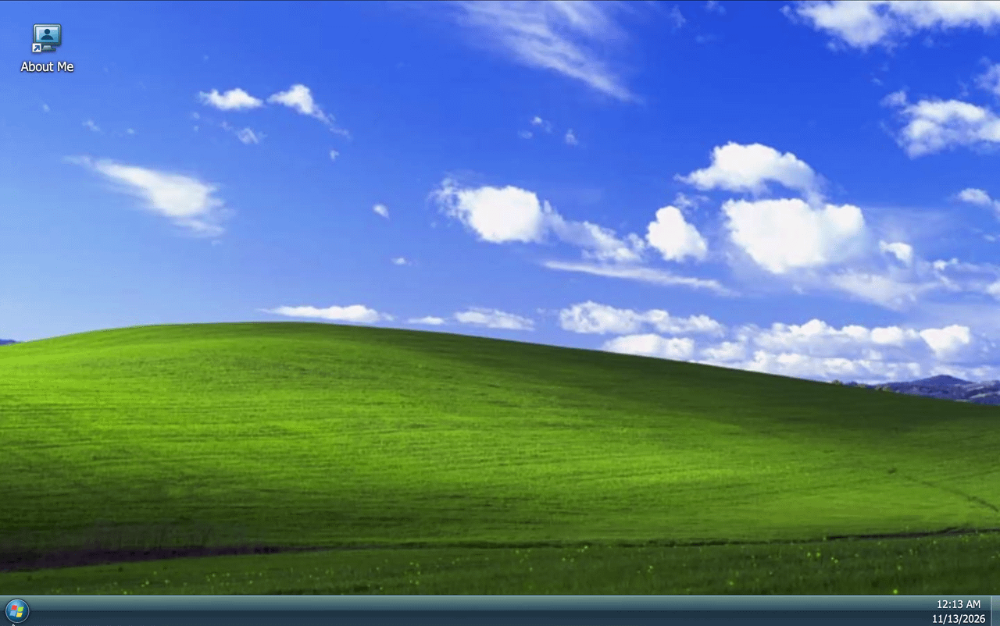

<a href="https://sanyamjain0315.github.io/sanyamjain0315/windows-xp-profile.html">
  <picture>
    <source media="(prefers-reduced-motion: reduce)" srcset="assets/windows7-still.png">
    
  </picture>
</a>

Click the desktop to explore.

## 

<a href="https://sanyamjain0315.github.io/sanyamjain0315/summary.html">
<picture>
  <source media="(max-width: 600px)" srcset="assets/summary-mobile.svg">
  
</picture>
</a>

Click the summary to open its replayable version.

Read the plain-text summary

I’m **Sanyam**, an M.S. Computer Science candidate at **Boston University**. I build event-driven backends and experiment with local AI agents. I’m happiest working out how a system behaves as events arrive, queues fill, and models make decisions.

I believe AI should be **open-source, private, and under its users’ control**. That keeps me tinkering with local models—and learning something new about backend engineering every day.

  <a href="https://www.linkedin.com/in/sanyamsuniljain/">LinkedIn</a> &nbsp; · &nbsp;
  <a href="mailto:sanyamjain0315@gmail.com">Email</a> &nbsp; · &nbsp;
  <a href="#showcase-projects">Showcase projects</a>

## 

### [NoDust](https://github.com/sanyamjain0315/NoDust)

A streaming pipeline that turns simulated air-quality sensor events into hourly aggregates and anomaly alerts. Kafka carries the events, Spark processes them, and PostgreSQL stores the results.

**Python · Kafka · Spark · PostgreSQL**  
[Architecture](https://github.com/sanyamjain0315/NoDust/blob/main/material/nodust-architecture.png) · [Run it locally](https://github.com/sanyamjain0315/NoDust#quick-start)

### [CUDA wildfire simulation](https://github.com/sanyamjain0315/cuda-wildfirespread-simulation)

Monte Carlo wildfire simulation on the GPU. I wrote the CPU baseline and implemented CUDA dynamic parallelism, then compared the approaches through profiling and benchmarks.

**C++ · CUDA · Performance profiling**  
[Benchmark report](https://github.com/sanyamjain0315/cuda-wildfirespread-simulation/blob/main/writeup/CUDA%20project%20report.pdf)

Also shipped: YT Gatekeeper

### [YT Gatekeeper](https://github.com/sanyamjain0315/yt-gatekeeper)

A Chrome extension I published to make YouTube use more intentional: daily watch-time tracking and a short pause before continuing.

**JavaScript · Chrome Extensions**  
[Chrome Web Store](https://chromewebstore.google.com/detail/yt-gatekeeper/paggklmpeoleddkmffideelfdcgmcbjm)

## 

<a href="assets/languages.json">
  <picture>
    <source media="(max-width: 600px)" srcset="assets/languages-mobile.svg">
    
  </picture>
</a>

Public repositories owned by me, including forks and this profile. Private repositories are excluded. HTML and Jupyter Notebook are excluded, and percentages are recalculated from the remaining language bytes—not proficiency or time spent. Only aggregated statistics are published; no repository inventory. Refreshed weekly via GitHub Actions.

## 

**Backend &amp; data** &nbsp; Python, Go, SQL, FastAPI, Kafka, Spark, PostgreSQL  
**AI &amp; systems** &nbsp; PyTorch, computer vision, llama.cpp, RAG, C++, CUDA  
**Infrastructure** &nbsp; Docker, AWS, Google Cloud, GitHub Actions

## 

- **BU Spark!** — Applied AI work for a healthcare administration client. The local AI phone-navigation project below is part of this engagement.
- **Local AI phone navigation** — Building an agent and a simulator to test when local models dial, wait, or hand off.
- **Computer vision &amp; ASL · Talks.ai** — Training continuous sign-language recognition models and benchmarking video architectures. I’m also exploring graph neural networks for sign recognition.
- **Go stream processing · BU** — Evaluating cache bypassing, asynchronous prefetching, and cross-batch caching across read-heavy and write-heavy workloads.

## 

No planned projects listed yet.

<!-- Add confirmed project ideas here; ongoing work is kept in the section above. -->

## 

I sketch regularly, get absorbed in story-driven games, and love old paintings. Aivazovsky’s *Ship on a Stormy Sea* is my favorite. I’m also into F1 and experimenting with local AI.
