<picture>
  <source media="(prefers-color-scheme: dark)" srcset="assets/header-dark.svg">
  <source media="(prefers-color-scheme: light)" srcset="assets/header-light.svg">
  
</picture>

  <a href="https://www.linkedin.com/in/sanyamsuniljain/">LinkedIn</a> &nbsp; · &nbsp;
  <a href="mailto:sanyamjain0315@gmail.com">Email</a> &nbsp; · &nbsp;
  <a href="#selected-work">Selected work</a>

I’m **Sanyam**, an M.S. Computer Science candidate at **Boston University**. I build event-driven backends and experiment with local AI agents. I’m happiest working out how a system behaves as events arrive, queues fill, and models make decisions.

I believe AI should be **open-source, private, and under its users’ control**. That keeps me tinkering with local models—and learning something new about backend engineering every day.

## Selected work

### [NoDust](https://github.com/sanyamjain0315/NoDust)

A streaming pipeline that turns simulated air-quality sensor events into hourly aggregates and anomaly alerts. Kafka carries the events, Spark processes them, and PostgreSQL stores the results.

**Python · Kafka · Spark · PostgreSQL**  
[Architecture](https://github.com/sanyamjain0315/NoDust/blob/main/material/nodust-architecture.png) · [Run it locally](https://github.com/sanyamjain0315/NoDust#quick-start)

### [CUDA wildfire simulation](https://github.com/sanyamjain0315/cuda-wildfirespread-simulation)

Monte Carlo wildfire simulation on the GPU. I wrote the CPU baseline and implemented CUDA dynamic parallelism, then compared the approaches through profiling and benchmarks.

**C++ · CUDA · Performance profiling**  
[Benchmark report](https://github.com/sanyamjain0315/cuda-wildfirespread-simulation/blob/main/writeup/CUDA%20project%20report.pdf)

### [YT Gatekeeper](https://github.com/sanyamjain0315/yt-gatekeeper)

A Chrome extension I published to make YouTube use more intentional: daily watch-time tracking and a short pause before continuing.

**JavaScript · Chrome Extensions**  
[Chrome Web Store](https://chromewebstore.google.com/detail/yt-gatekeeper/paggklmpeoleddkmffideelfdcgmcbjm)

### Research &amp; ongoing work

- **Local AI for phone navigation · BU Spark!** — Building an agent for a healthcare administration client, with a simulator to test when local models dial, wait, or hand off.
- **Computer vision &amp; ASL · Talks.ai** — Training continuous sign-language recognition models and benchmarking video architectures. I’m also exploring graph neural networks for sign recognition.
- **Go stream processing · BU** — Evaluating cache bypassing, asynchronous prefetching, and cross-batch caching across read-heavy and write-heavy workloads.

### Tools I work with

**Backend &amp; data** &nbsp; Python, Go, SQL, FastAPI, Kafka, Spark, PostgreSQL  
**AI &amp; systems** &nbsp; PyTorch, computer vision, llama.cpp, RAG, C++, CUDA  
**Infrastructure** &nbsp; Docker, AWS, Google Cloud, GitHub Actions

### Away from the terminal

I sketch regularly, get absorbed in story-driven games, and love old paintings. Aivazovsky’s *Ship on a Stormy Sea* is my favorite—the original painting at the top of this page.

Ivan Aivazovsky · <i>Ship on a Stormy Sea</i> · 1858

