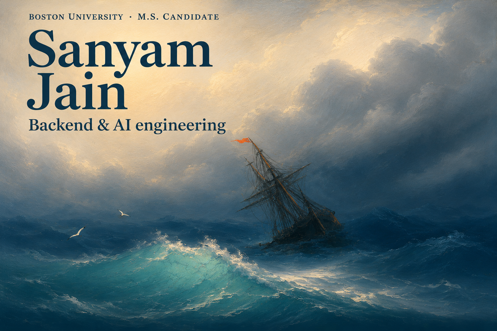
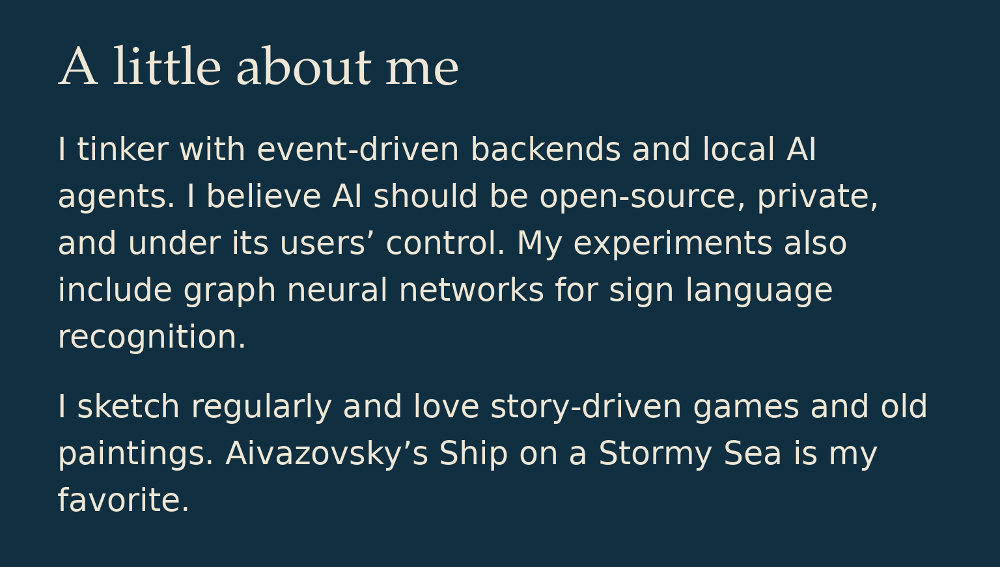
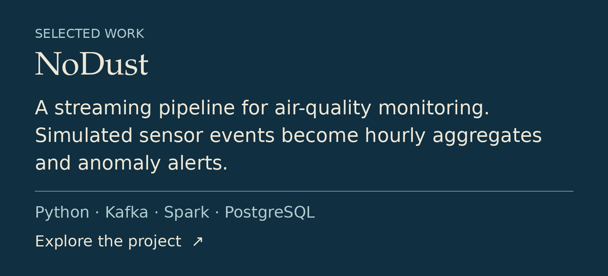
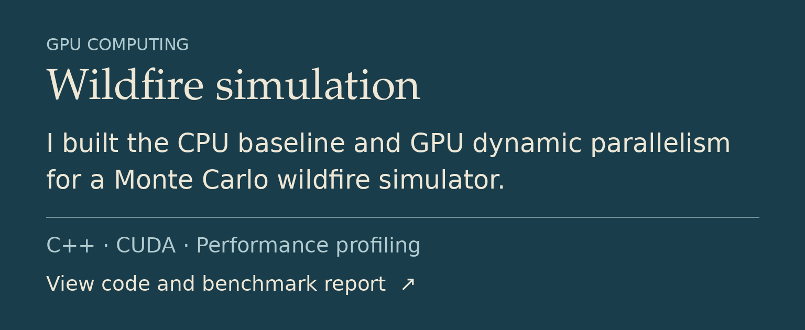
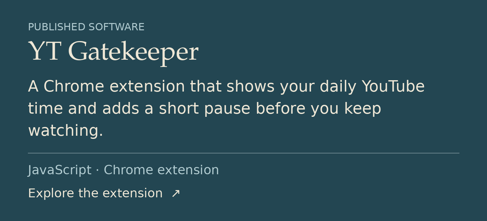
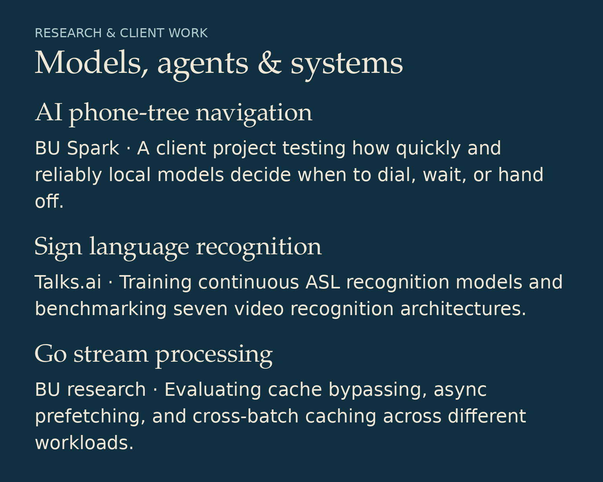
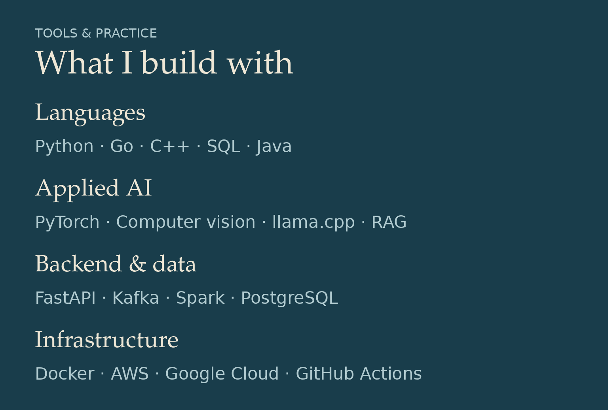

  

  <a href="https://www.linkedin.com/in/sanyamsuniljain/">LinkedIn</a> &nbsp; · &nbsp;
  <a href="mailto:sanyamjain0315@gmail.com">Email</a> &nbsp; · &nbsp;
  <a href="#projects-and-skills">Projects &amp; skills in text</a>

Read the projects and skills in text

I’m an M.S. Computer Science candidate at Boston University, working on applied AI and backend systems.

I tinker with event-driven backends and local AI agents. I believe AI should be open-source, private, and under its users’ control. My experiments also include graph neural networks for sign language recognition.

I sketch regularly and love story-driven games and old paintings. Aivazovsky’s Ship on a Stormy Sea is my favorite :)

### Selected work

- **NoDust** — I built a pipeline that reads simulated sensor data from Kafka, stores hourly averages in PostgreSQL, and publishes anomaly alerts back to Kafka. [Code](https://github.com/sanyamjain0315/NoDust) · [Architecture](https://github.com/sanyamjain0315/NoDust/blob/main/material/nodust-architecture.png) · [Quick start](https://github.com/sanyamjain0315/NoDust#quick-start)
- **CUDA wildfire simulation** — I wrote the CPU baseline and implemented dynamic parallelism in the GPU version. In our benchmark, kernel time was approximately 1.2 ms with dynamic parallelism and 40 ms with one CUDA stream per simulation. [Code](https://github.com/sanyamjain0315/cuda-wildfirespread-simulation) · [Report](https://github.com/sanyamjain0315/cuda-wildfirespread-simulation/blob/main/writeup/CUDA%20project%20report.pdf)
- **YT Gatekeeper** — I published a Chrome extension that shows daily YouTube time and adds a short pause before you keep watching. [Code](https://github.com/sanyamjain0315/yt-gatekeeper) · [Chrome Web Store](https://chromewebstore.google.com/detail/yt-gatekeeper/paggklmpeoleddkmffideelfdcgmcbjm)

### Research and client work

- **BU Spark!** — I’m building a phone-tree navigation agent for a healthcare administration client. I wrote a simulator to test how quickly and reliably local models decide when to dial, wait, or hand off.
- **Talks.ai** — I’ve trained models for continuous American Sign Language recognition and benchmarked seven video recognition architectures.
- **Go stream processing** — At BU, I evaluated cache bypassing, async prefetching, and cross-batch caching across read-heavy and write-heavy workloads.

### Skills

| Area | Tools and experience |
| --- | --- |
| Languages | Python, Go, C++, SQL, Java |
| Applied AI | PyTorch, computer vision, llama.cpp, RAG |
| Backend and data | FastAPI, Kafka, Spark, PostgreSQL |
| Infrastructure | Docker, AWS, Google Cloud, GitHub Actions |

Cover artwork reinterprets Ivan Aivazovsky’s Ship on a Stormy Sea (1858).

